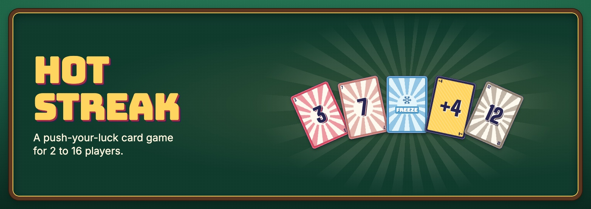

# Flip 7



A multiplayer push-your-luck card game for **2–16 players**. Share a room link or code and join with a display name. No account is required.

**[Play Flip 7](https://flip7.owenvey.com/)** · [How to play](#how-to-play) · [Local development](#local-development) · [Deploy](#deploy-to-cloudflare)

## How to play

1. **Create a room** and share the invite link or room code.
2. **Join with a display name.** The host can start once two players have joined. Playing alone or short-handed? The host can **add bots** in the lobby. Bots count toward the 16-player limit and make their own moves after a short pause, or a shorter one if the host sets them to Fast.
3. **Set up the table.** In the lobby, the host picks the winning score (100, 200, or 300) and can **lock the room** so nobody new can join. Players already in the room can still rejoin. During a game, the host can still lock or unlock the room and change bot speed from **Settings** in the table header. The winning score only changes in the lobby.
4. **Hit or Stay.** Hit to draw another card, or Stay to bank your points and sit out the round. You need a card in front of you to Stay. Drawing a duplicate Number card makes you bust for zero points unless you have a Second Chance.

### Rounds and scoring

The dealer rotates each round and deals an opening card to each active player in order, starting on the dealer's left. Action cards interrupt the deal and resolve as soon as they appear. A player who already took cards from a Flip Three before their opening card chooses Hit or Stay instead. The round ends when everyone is out or a player **Flips 7** by collecting seven unique Number cards. A Flip 7 adds 15 bonus points and ends the round for everyone. Everyone who hasn't busted scores what they already have.

Add up your Number cards, apply the ×2 multiplier if you have it, then add any other Score Modifier points and the Flip 7 bonus. At the end of a round, the sole leader wins if they have at least the winning score: 200 points unless the host chose 100 or 300. Play continues on a tie for first. After a round, the host starts the next round. When the game ends, the host can **play again** with the same players and settings, or head back to the lobby to change them.

### Cards

When assigning **Freeze** or **Flip Three**, you can choose any eligible active player, including yourself.

- **Freeze** makes the receiving player bank their points and exit the round.
- **Flip Three** makes the receiving player take up to three cards in a row. A Freeze or Flip Three drawn during that sequence is held. If the player survives all three cards, they assign each held card in the order it was drawn. The cards then take effect in that order, after any effects already waiting. A held card whose target is no longer active is discarded.
- **Second Chance** saves you from the next duplicate Number card. Discard both cards and keep playing. If you already have a Second Chance, give the extra card to an active player without one, or discard it if nobody can take it.

When the deck runs out, the discard pile is shuffled into a new deck. Table cards stay out of the deck until round cleanup, even if a player leaves or is kicked. If the deck and the discard pile are both empty, the round ends and everyone who hasn't busted scores what they hold. The in-game **Rules** button has a quick reference.

<details>
<summary>See all 94 cards in the deck</summary>

| Cards                                            |     Count |
| ------------------------------------------------ | --------: |
| One 0, one 1, two 2s, and so on up to twelve 12s |        79 |
| Score Modifier cards +2, +4, +6, +8, +10, and ×2 |         6 |
| Freeze, Flip Three, and Second Chance            | 3 of each |
| **Total**                                        |    **94** |

</details>

### Rejoining and offline players

The browser remembers your display name and room identity. Refreshing or reopening the link in the same browser profile returns you to the same player while that player is still in the room. Use **Leave** to give up your place.

The host can remove players, from the player list in the lobby or the Scores list during a game, and move for an offline player the game is waiting on. While someone else is online, the host role passes to a connected player after 20 seconds away. After a 30-second stall, the game makes the missing move automatically. Bots only play while at least one person is online, and a room is deleted when the last person leaves a table of bots. A room expires after 24 hours of inactivity once all connections are closed.

## Local development

Use Node.js 26.12+ on the 26.x line and pnpm (the exact version is pinned in [package.json](package.json)). Vite runs the Worker and its Durable Objects locally in workerd. Local development needs no Cloudflare credentials or environment variables.

```sh
pnpm install
pnpm dev
```

Open [localhost:3000](http://localhost:3000), create a room, and copy its link.

> **Test with two players.** Open a new tab directly at `http://localhost:3000/room/<code>?fresh`. The development-only `?fresh` flag stores the room identity per tab. Use a separate browser profile to test distinct players against a production build.

### Commands

| Command | What it does |
| --- | --- |
| `pnpm dev` | Starts the local app and Worker |
| `pnpm test --run` | Runs the Vitest suite once. Use `pnpm test` for watch mode |
| `pnpm check` | Checks lint and formatting with Ultracite |
| `pnpm fix` | Applies Ultracite fixes |
| `pnpm typecheck` | Regenerates Worker types and checks both TypeScript projects |
| `pnpm build` | Builds the client and Worker |
| `pnpm serve` | Previews the production build locally |

## Architecture

The app uses Solid 2.0, ui-sdk, and Vite. Cloudflare Workers serves the app and routes WebSockets to a SQLite-backed Durable Object for each room. The Durable Object owns room state, and the browser and Worker share the game rules. See [AGENTS.md](AGENTS.md) for the code map and [GLOSSARY.md](GLOSSARY.md) for game terminology.

## Deploy to Cloudflare

With access to a Cloudflare account, authenticate with the project's `cf` CLI, then build and deploy.

```sh
pnpm exec cf auth login
pnpm deploy
```

[cloudflare.config.ts](cloudflare.config.ts) defines the Worker and its `GAME_ROOM` binding. The deployment script builds to `.cloudflare/output/v1` and deploys that prebuilt output.

## Contributing

Report bugs and propose changes in [GitHub Issues](https://github.com/OwenVey/flip7/issues). For player-facing bugs, include the steps to reproduce and what you expected to happen. Before opening a pull request, run `pnpm check`, `pnpm typecheck`, and `pnpm test --run`. Installing dependencies also sets up the Lefthook pre-commit hook, which formats and fixes supported staged files.

## License

Flip 7 is released under the [MIT License](LICENSE).
